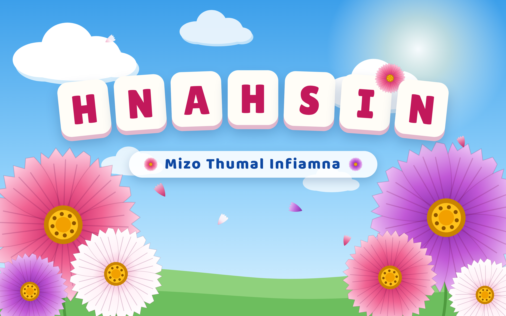
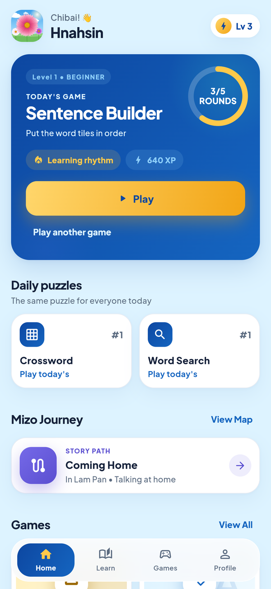
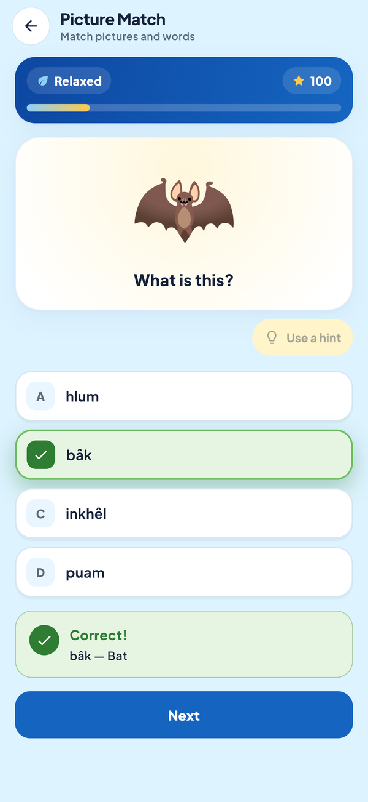
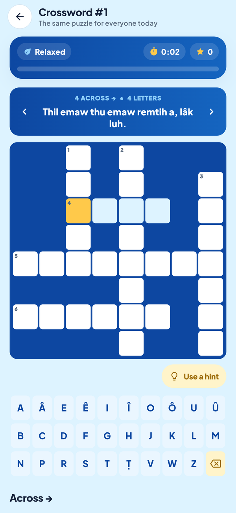
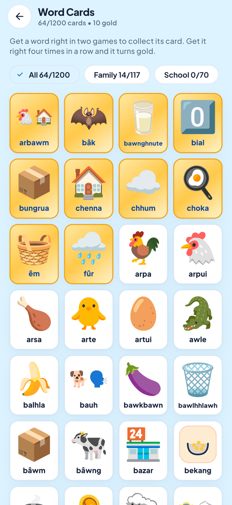

<p align="center"></p>

# Hnahsin

**Khelh la, zir la, thiam rawh.** — *Play, learn, master.*

Hnahsin (*Mizo Thumal Infiamna*) is a set of word games for learning the
**Mizo language** (lus), for players from age 5 to adults. The buttons and
instructions are in simple English so anyone can play; the Mizo is in the
games themselves, so players pick it up as they play. It works offline on
phones, and every word, question and sentence is edited by people in a
**Google Sheet**.

<p align="center">
  
  
  
  
</p>

## Features

- **8 games** — Picture Match, Spelling, Word Search, Word Chain, Tawng Upa
  (old sayings), Crossword, Thumal Kawp (memory cards) and Sentence Builder.
  Each opens with a short looping demo of how to play.
- **Daily puzzles** — one Crossword and one Word Search a day, the same for
  everyone, easiest on Monday; the result can be shared without spoiling it.
- **Word cards** — a sticker book that collects every word the player gets
  right in two games (gold after four in a row).
- **Adaptive difficulty** — each game has its own level (1–7) that rises and
  falls with the learner, aiming for about 78% correct answers; words the
  player misses come back sooner.
- **Content** — 1,200 Mizo words with meanings, example sentences and
  pictures, 203 tawng upa, and 383 sentences with English meanings.
  Word Chain also accepts about 6,000 more Mizo words.
- **Sound and motion** — sound effects, bounces, confetti; Profile can turn
  sound off and reduce motion.
- **16 languages** — buttons, messages and game instructions follow the
  phone's language: English, 日本語, 简体中文, 繁體中文, 한국어, हिन्दी, မြန်မာ,
  ไทย, Bahasa Indonesia, Tiếng Việt, Español, Français, Deutsch, Português,
  العربية (right to left) and Русский; Profile can pick another. The games'
  Mizo stays Mizo.
- **Offline first** — content packs are verified by SHA-256 and cached on the
  device; progress stays on the device.
- **Content Sheet** — words, pictures, questions and all game text are edited
  in a Google Sheet; its **Hnahsin → 🚀 Publish to the app** menu checks
  every row and publishes the content pack. No server to run.
- Phone-first design that also adapts to tablets and desktop browsers.

## Quick start (macOS)

You need **Flutter 3.x**.

```bash
git clone https://github.com/thadomaloma/hnahsin.git
cd hnahsin
./run_mac.command            # checks the Mac, runs analyze + tests, opens the app
```

Without a content URL the app plays with its built-in starter words. To use
the published content, pass the content pack's location:

```bash
flutter run --dart-define=HNAHSIN_API_BASE_URL=https://thadomaloma.github.io/hnahsin-content
```

Release builds for the App Store and Play Store need the same `--dart-define`;
`scripts/build_release.sh` passes it for you:

```bash
scripts/build_release.sh          # App Store .ipa and Play Store .aab
scripts/build_release.sh ios      # App Store only
scripts/build_release.sh android  # Play Store only
```

The old name, `THUMAL_QUEST_API_BASE_URL`, still works.

## Editing content

Content lives in the **Hnahsin content** Google Sheet (tabs Words, Questions,
Sentences, Game text, App text; the how-to is on its Help tab):

1. Add or change rows. Only rows whose **Status** is *Live* reach the app.
2. **Hnahsin → ✅ Check for problems** lists anything wrong, with links to the rows.
3. **Hnahsin → 🚀 Publish to the app** publishes the pack to
   [hnahsin-content](https://github.com/thadomaloma/hnahsin-content) on GitHub
   Pages; apps pick it up on their next sync, without an app update.

Setup and the sheet's script: [`content_studio/README.md`](content_studio/README.md).
The pack format is [`docs/API_CONTENT_PACK_V1.md`](docs/API_CONTENT_PACK_V1.md).

## Tests

```bash
flutter analyze && flutter test          # app
node --test content_studio/test          # content Sheet's pack builder
python3 tool/check_l10n.py               # every language has every text
```

## Translations

The English texts are in `lib/src/app_text.dart` (and the Sheet's App text
tab) and `lib/src/game_text.dart`. Each other language is a file in `l10n/`
(`ja.json`, `zh_Hans.json`, …). After adding a text or changing a
translation, run `python3 tool/check_l10n.py` and then
`python3 tool/gen_l10n.py`, which writes `lib/l10n/`.

## Project structure

```text
lib/            Flutter app (screens, games, adaptive engine, content sync)
content_studio/ Apps Script for the content Google Sheet (check + publish)
content/        Source word lists from the Kumtluang and Vartian primers
assets/         Branding, fonts, illustrations, sound effects, Mizo word list
design/         Hnahsin logo and icon source art
docs/           Design system, product notes and project history
scripts/        Release builds and Mac diagnostics
l10n/           Translations of the app's texts, one JSON file per language
tool/           App text rows for the Sheet; Mizo word list; translation tools
```

## Credits

- Vocabulary selection is cross-referenced with the Mizoram SCERT *Kumtluang*
  and *Vartian* primers; all definitions and example sentences are original
  (see `content/pilot/kumtluang/README.md`).
- Sentences: [Mizo-Language-Corpus-4M](https://huggingface.co/datasets/MWirelabs/mizo-language-corpus-4M)
  by MWireLabs (CC BY 4.0; from IndicNLCorp, FineWeb and DIPR Mizoram) and the
  [Mizo–English parallel dataset](https://huggingface.co/datasets/hillbyte/mizo-english-parallel-20k)
  by Hillbyte AI, picked by hand.
- Word Chain's word list (`assets/mizo_words.txt`, built by
  `tool/mizo_lexicon.py`) comes from J.F. Laldailova's *English–Lushai
  Dictionary*, used with its owners' permission.
- Sound effects were made for Hnahsin (`assets/sounds/`).
- Font: [Plus Jakarta Sans](https://github.com/tokotype/PlusJakartaSans) (SIL OFL 1.1).
- Icons: game-icons.net (CC BY 3.0), Tabler (MIT) and Material Design Icons
  (Apache 2.0) — see `assets/illustrations/ATTRIBUTION.md`.

## License

[MIT](LICENSE) © 2026 Maloma Thado. Third-party fonts, icons and content keep
their own licences (listed above).

Development history and earlier phase notes: [`docs/PROJECT_HISTORY.md`](docs/PROJECT_HISTORY.md).
